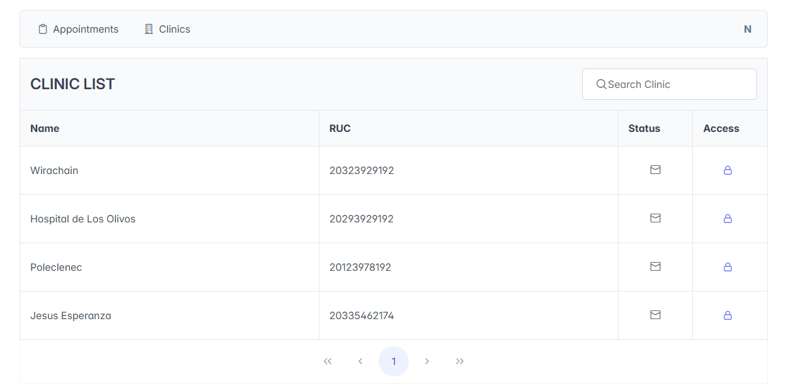
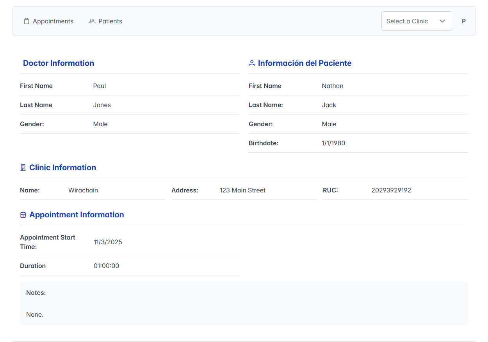
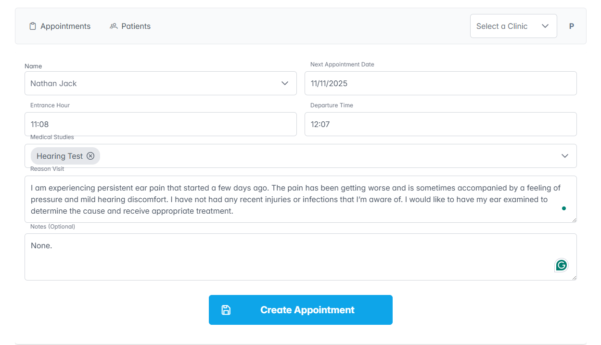
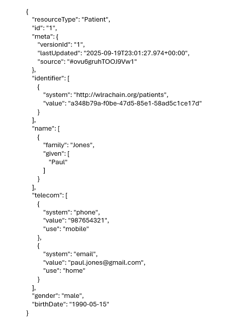

# WiraChain Platform

WiraChain is a healthcare interoperability platform that combines **HL7 FHIR R4** with a permissioned **Hyperledger Besu** blockchain. Clinical data remain in conventional/FHIR storage, while patient consent decisions are recorded on-chain as an immutable audit trail.

This repository is the **platform superproject**. It assembles the application repositories as Git submodules so the full stack can be cloned, versioned, and started consistently.

## Technologies

- **Frontend:** React 19, TypeScript, Vite 6, Redux Toolkit / RTK Query, React Router 7, PrimeReact, Tailwind CSS, Vitest
- **Backend:** .NET 8 / ASP.NET Core Web API, Entity Framework Core + MySQL, JWT + BCrypt, AutoMapper, Swagger, HL7 FHIR R4 (`Hl7.Fhir.R4`), Nethereum
- **Blockchain:** Hyperledger Besu (QBFT in production topology, dev node in Compose), Solidity 0.8.26, ethers.js v6, Node.js/Express contract API
- **Interoperability:** HAPI FHIR server, HL7 FHIR R4 resources
- **Data:** MySQL 8.0, CSV datasets (entities, event logs, latency, TPS)
- **Infrastructure:** Docker, Docker Compose, Nginx, AWS-oriented deployment described in the article

## Features

- Patient-controlled permission grant/revoke with on-chain event emission; no clinical data are stored on-chain.
- FHIR R4 patient record create/update/delete against an external HAPI FHIR server.
- Authentication with JWT and role-based access control for patient, doctor, clinic administrator, and system administrator dashboards.
- CRUD and paginated search for clinics, doctors, patients, specialties, tests, and consultations.
- Chunked on-chain event queries filtered by pseudonymized patient GUID and clinic ID.
- Reproducible synthetic datasets and performance measurements (latency/TPS) from the validation study.
- One-command local stack through Docker Compose.

## Documentation snapshots

These screenshots show representative UI flows and data formats documented in the project:

| Preview | Description |
| --- | --- |
| `docs/figure_4.png` | Patient authorization and clinic access management |
| `docs/figure_5.png` | Medical record visualization |
| `docs/figure_6.png` | Clinical consultation creation |
| `docs/figure_7.png` | Imported patient resource in FHIR JSON format |

<p align="center">
  
</p>

<p align="center">
  
</p>

<p align="center">
  
</p>

<p align="center">
  
</p>

## Getting started

Prerequisites: Git, Docker with Compose, and (for individual component development) the .NET 8 SDK and Node.js.

### 1. Clone with submodules

```bash
git clone --recurse-submodules https://github.com/xenocore-wirachain/platform.git
cd platform
```

If you already cloned the platform without submodules, run `make init`.

### 2. Use the Makefile

Run `make` (or `make help`) to list every target.

| Command | Description |
| --- | --- |
| `make init` | Fetch and check out all submodules |
| `make update` | Advance submodules to the latest commit on their default branch |
| `make status` | Show pinned submodule commits and working tree status |
| `make env` | Create `wirachain-docker/.env` from the template (does not overwrite) |
| `make up` | Build and start the full stack in the background |
| `make logs` | Follow logs of all services |
| `make ps` | Show service status |
| `make restart` | Restart all containers |
| `make down` | Stop and remove containers |
| `make clean` | Stop the stack and delete volumes (removes database data) |
| `make dev-backend` / `make dev-frontend` / `make dev-contracts` | Run a single component locally |
| `make test-backend` / `make test-frontend` | Run component tests |

### 3. Configure and start the full stack

```bash
make env   # then edit wirachain-docker/.env with your credentials and ports
make up
```

| URL | Service |
| --- | --- |
| `http://localhost:3000` | Frontend |
| `http://localhost:5273/swagger` | Backend API docs |
| `http://localhost:8080/fhir` | HAPI FHIR endpoint |
| `http://localhost:4121/api-docs` | Smart-contract API docs |

Ports are driven by `.env` (`BACKEND_PORT`, `FRONTEND_PORT`, `FHIR_PORT`, `BESU_RPC_PORT`, `ABI_DISPATCHER_PORT`). See [`wirachain-docker/README.md`](wirachain-docker/README.md) for service details and deployment notes.

### 4. Work on a single component

Use `make dev-backend`, `make dev-frontend` or `make dev-contracts`. Each submodule also has its own README with detailed instructions.

Before emitting on-chain events, compile and deploy the permission contract to the Besu node using the CLI helpers in `wirachain-smart-contract-deployment/scripts/` and update the stored address artifact. `EthereumSettings__SmartContractManagerUrl` must point to a service exposing `GET /contract/1` with the ABI and address.

## Related articles

If you use this platform in research, please cite the following works.

**Journal article (APA 7):**

```text
Grau, L., Urrunaga, J., & Santisteban, J. (2026). WiraChain: A blockchain and FHIR-based platform for improving clinical data interoperability in healthcare. Frontiers in Public Health, 14, Article 1746772. https://doi.org/10.3389/fpubh.2026.1746772
```

**Conference paper (APA 7):**

```text
Grau, L., Urrunaga, J., & Santisteban, J. (2026). Wirachain: Blockchain and Fast Healthcare Interoperability Resources for clinical data interoperability. In 2026 International Conference on Artificial Intelligence, Computer, Data Sciences and Applications (ACDSA) (pp. 1–6). IEEE. https://doi.org/10.1109/ACDSA67686.2026.11468238
```

- [Frontiers in Public Health article](https://www.frontiersin.org/journals/public-health/articles/10.3389/fpubh.2026.1746772/full)
- [IEEE ACDSA 2026 paper](https://ieeexplore.ieee.org/document/11468238)
